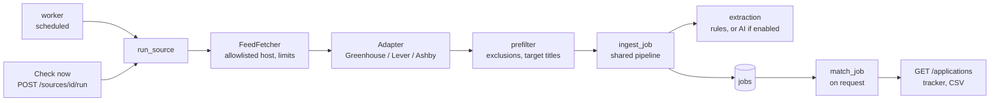

# Job discovery and application tracking

Milestone 4 finds new jobs at companies the user follows, runs them through the same pipeline as pasted jobs, and tracks each application's status. JobPilot never applies for jobs, never scrapes job pages, and never sends anything about the user to job boards.

## Architecture

| Part | Module | Notes |
| --- | --- | --- |
| Adapters | `services/sources/providers.py` | One class per provider: host, feed URL, JSON → `NormalizedPosting` |
| Fetcher | `services/sources/fetcher.py` | Allowlisted HTTPS host, no redirects, timeouts, retries, size cap |
| Discovery run | `services/discovery.py` | Filter, store, observe, close, health |
| Job pipeline | `services/jobs.py` | `ingest_job`, shared with `POST /jobs`; dedup → extraction → store |
| Matching | `services/matching.py` | Unchanged; scores are computed on request |
| Scheduler | `jobpilot/worker.py` | `worker` Compose service |
| Tracker | `services/tracker.py`, `api/routes/applications.py` | Rows, filters, sorting, cursor, CSV |
| Statuses | `services/applications.py` | Manual status changes with history |

### Adding a provider

Write a class with `provider`, `label`, `host`, `docs_url`, `feed_url(board)`, and `parse(payload)` in `providers.py`, register it in `ADAPTERS`, and add the provider name to the `Provider` literal in `api/routes/sources.py`. Use only an official, documented public feed whose terms allow this use. Add sample-feed tests in `tests/feed_samples.py`.

## Sources

| Provider | Endpoint | Docs |
| --- | --- | --- |
| Greenhouse | `https://boards-api.greenhouse.io/v1/boards/{board}/jobs?content=true&pay_transparency=true` | [Job Board API](https://developers.greenhouse.io/job-board.html) |
| Lever | `https://api.lever.co/v0/postings/{board}?mode=json` | [Postings API](https://github.com/lever/postings-api) |
| Ashby | `https://api.ashbyhq.com/posting-api/job-board/{board}?includeCompensation=true` | [Job Posting API](https://developers.ashbyhq.com/docs/public-job-posting-api) |

These are the providers' own public, unauthenticated APIs, published so job boards can be read programmatically. JobPilot reads only these feeds. It does not fetch job pages or apply links, log in, or use any other site. Review each provider's terms before relying on them; they can change.

A **board** is the company's name in its job-board address (for example, `examplecorp` in `boards.greenhouse.io/examplecorp`). The sources page also accepts a pasted board link. Board names must match `^[A-Za-z0-9][A-Za-z0-9._-]{0,99}$` and may not contain `..`.

**Live check (2026-10-14, one request per provider).** Greenhouse (215 postings) and Lever (312 postings) parsed completely; descriptions, dates and links were present for all, and location, arrangement, type and pay were present wherever published. The Ashby board tried was over the then-default 10 MB size limit, so the limit was raised to 30 MB; Ashby parsing is tested only against sample data so far.

## Discovery runs

1. **Request budget.** If the attempts in the last hour reach `DISCOVERY_MAX_REQUESTS_PER_HOUR`, the run is skipped without fetching and the source is retried in 15 minutes.
2. **Fetch** the feed through `FeedFetcher` (see limits below), then **parse** it with the adapter. Postings without an https link, title or description, and unlisted Ashby jobs, are skipped. At most `DISCOVERY_MAX_POSTINGS_PER_SOURCE` are processed.
3. **Already-known postings** (same source and provider posting id) only get `last_seen_at` updated (and reopen if they had closed). They are never re-extracted.
4. **Prefilter** new postings without storing them: excluded companies, excluded keywords, and, if target titles are set, a title-word overlap of at least 50% with one of them.
5. **Store** the rest with `ingest_job` as `discovered`. Duplicate checks (provider id, canonical URL, description fingerprint) run before extraction. A job you pasted with the same link is linked to the source instead of duplicated.
   - Location, work arrangement, employment type and salary stated in the feed **override** text extraction.
   - Extraction uses local rules unless `DISCOVERY_USE_AI=true` and AI is configured.
6. **Archive** new jobs that clearly fail a must-match preference, with the reasons in their status history. Unknown details never cause archiving.
7. **Close**: when the feed was read completely, postings no longer in it get `closed_at` ("No longer listed"). A truncated feed never closes anything.
8. **Health**:
   - **Success** sets the source to `healthy`, resets the failure count, and schedules the next run after `interval_minutes`.
   - **Failure** sets it to `degraded`, then `failing` after 3 in a row, and backs off exponentially from the interval (capped at 24 hours). The error code and a user-safe message are stored.

Runs are **idempotent**: repeating one produces no duplicates and only refreshes observations.

### Request limits

| Control | Default | Setting |
| --- | --- | --- |
| Scheduled checks | Off | `DISCOVERY_ENABLED` |
| Interval per source | 6 hours (minimum 60 minutes) | per source; `DISCOVERY_DEFAULT_INTERVAL_MINUTES`, `DISCOVERY_MIN_INTERVAL_MINUTES` |
| "Check now" cooldown | 10 minutes per source (429 with `Retry-After`) | `DISCOVERY_MANUAL_COOLDOWN_MINUTES` |
| Requests per hour, all sources | 60 | `DISCOVERY_MAX_REQUESTS_PER_HOUR` |
| Pause between sources | 2 seconds; one source at a time | `DISCOVERY_DELAY_BETWEEN_SOURCES_SECONDS` |
| Timeout | 15 seconds (5-second connect) | `DISCOVERY_TIMEOUT_SECONDS` |
| Retries | 2, on timeouts, network errors, 408/429/5xx; exponential backoff or `Retry-After`, capped at 30 seconds | `DISCOVERY_MAX_RETRIES`, `DISCOVERY_RETRY_BASE_DELAY_SECONDS` |
| Response size | 30 MB, abandoned while streaming | `DISCOVERY_MAX_RESPONSE_BYTES` |
| Postings per run | 500 | `DISCOVERY_MAX_POSTINGS_PER_SOURCE` |
| AI for discovered jobs | Off | `DISCOVERY_USE_AI` (also needs the AI settings) |

### Scheduler

`python -m jobpilot.worker` (the `worker` service) wakes every `DISCOVERY_WORKER_TICK_SECONDS` (default 60). It runs only when `DISCOVERY_ENABLED=true`; otherwise it idles.

Each due, enabled source is claimed with `SELECT … FOR UPDATE SKIP LOCKED`, and its `next_run_at` is moved forward as a lease before fetching. Several workers therefore never fetch the same board at once, and a crashed run is retried at the next interval.

To turn it on, set `DISCOVERY_ENABLED=true` in `.env`, then run `docker compose --env-file .env -f infra/compose.yaml up -d worker`. `GET /sources/status` reports whether scheduling is on, the requests used this hour, the next check time, and failing sources.

## Application tracking

Statuses: `discovered`, `shortlisted`, `ready_to_apply`, `applied`, `interviewing`, `offered`, `rejected`, `archived`. Pasted jobs start `shortlisted`; discovered jobs start `discovered`. Only the user changes status (`PATCH /jobs/{id}/application` with `status`, `status_note`, `notes`, or `seen`). Every change is kept in `job_status_events` (`GET /jobs/{id}/application/history`).

A job is **new** while it is `discovered`, unseen, and still listed; opening it marks it seen.

### Tracker API

`GET /applications` returns `{items, next_cursor, total}`.

| Parameter | Meaning |
| --- | --- |
| `view` | `new`, `saved` (shortlisted, ready to apply), `in_progress` (applied, interviewing, offered), `all` (everything except archived), `archived` |
| `status` | Repeatable; overrides `view`'s statuses |
| `min_score`, `eligible_only` | Match score floor; only jobs passing must-match preferences |
| `found_from`, `found_to` | Dates (inclusive) when the job was first seen or pasted |
| `company`, `q` | Case-insensitive contains; `q` searches title and company |
| `min_salary`, `salary_currency`, `include_unknown_salary` | Minimum **annual** pay (hourly × 2080, monthly × 12). No salary, or a different currency, counts as unknown and is included unless `include_unknown_salary=false` |
| `sort`, `order` | `score`, `found`, `company`, `salary`, `status_changed`; `asc`/`desc`. Missing values sort last. |
| `limit`, `cursor` | Page size (1–200, default 50) and the previous page's `next_cursor` |

`GET /applications/summary` gives tab counts. `GET /applications/export.csv` takes the same filters and returns up to 5,000 rows. Private notes are excluded, cells starting with `=`, `+`, `-` or `@` are prefixed with `'` to stop spreadsheet formulas, and the response is `no-store`.

Scores are computed on request, so filtering and sorting by score happen after the database query. The cursor is an opaque offset bound to the filters (a cursor reused with different filters is rejected). This is fine for one person's jobs (hundreds to low thousands); see limitations.

## Using the API from a mobile app

The same FastAPI service is meant to serve web, iOS and Android.

- **Contract.** The OpenAPI schema at `/openapi.json` (browse it at `/docs`) is the contract. A React Native/Expo app can generate a typed client from it.
- **Response shapes.** Responses are JSON objects, and lists that can grow are paginated with `next_cursor`. Clients should ignore unknown fields, so fields can be added without breaking apps.
- **Errors.** Errors use `{"detail": "..."}` with user-safe messages. Rate limits return 429 with `Retry-After`.
- **Server-side logic.** Business logic (matching, filters, status rules, resume rules) lives on the server, so apps only render and submit.
- **Before a mobile release:**
  - Add authentication with per-user data; the API is single-user today.
  - Serve the API over HTTPS.
  - Version the API (for example a `/v1` prefix) or commit to additive-only changes.
  - Add the app's origin or no-origin requests to the CORS and auth design.
  - Store tokens in the device's secure storage.

## Privacy and security

- **Outbound requests:** only HTTPS to the three provider hosts. Each request URL is checked against the adapter's host, redirects are not followed, and board names are validated to block path or host injection.
- **What is sent:** requests carry only the board name and an identifying User-Agent, never cookies, keys, or user data.
- **Stored text:** job descriptions are converted from HTML to plain text (scripts and styles dropped) and are never rendered as HTML.
- **Logs:** counts, ids, and status codes only. The `httpx`/`httpcore` loggers are kept at WARNING because they would otherwise log request URLs, revealing which companies the user follows. Tests check this.
- **CSV exports:** formula injection is neutralised, private notes are excluded, and responses are `no-store`.
- **Tests:** they cannot reach the internet. The test client's fetcher raises on any request, and discovery tests use fictional sample feeds.
- **No authentication yet.** The API is single-user and bound to localhost; do not expose it on a network.

## Limitations

- Discovery covers only companies the user follows on Greenhouse, Lever or Ashby. There is no search across all employers.
- Title prefiltering uses word overlap, so synonyms ("SWE" vs "Software Engineer") are missed unless added as target titles.
- Ashby parsing is verified only against sample data; Greenhouse and Lever were checked once against live feeds.
- Scores are computed per request; tens of thousands of jobs would need cached scores and database-side filtering.
- Feeds above 30 MB are rejected unless the limit is raised.
- Unchanged postings are not re-extracted when their description changes. Re-extract from the job page if needed.
